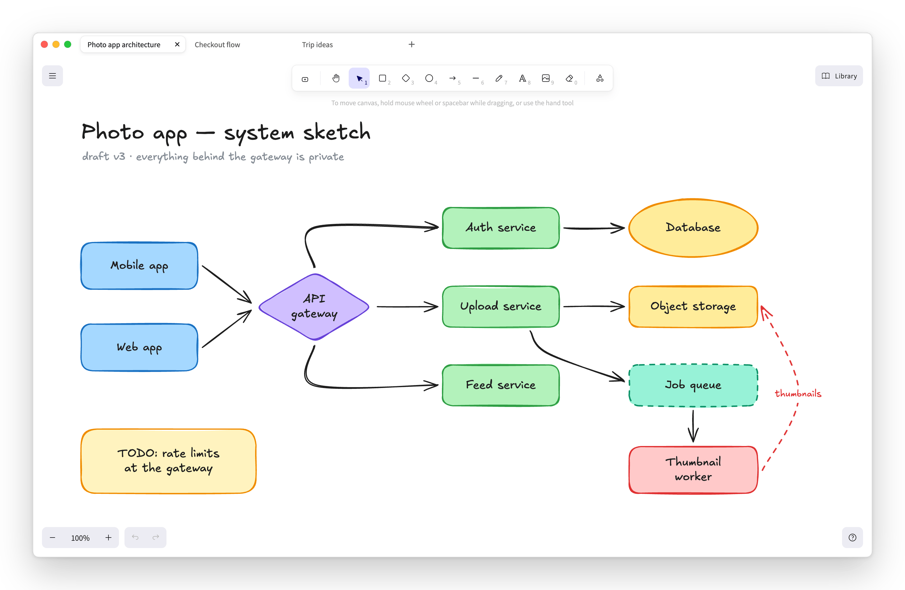
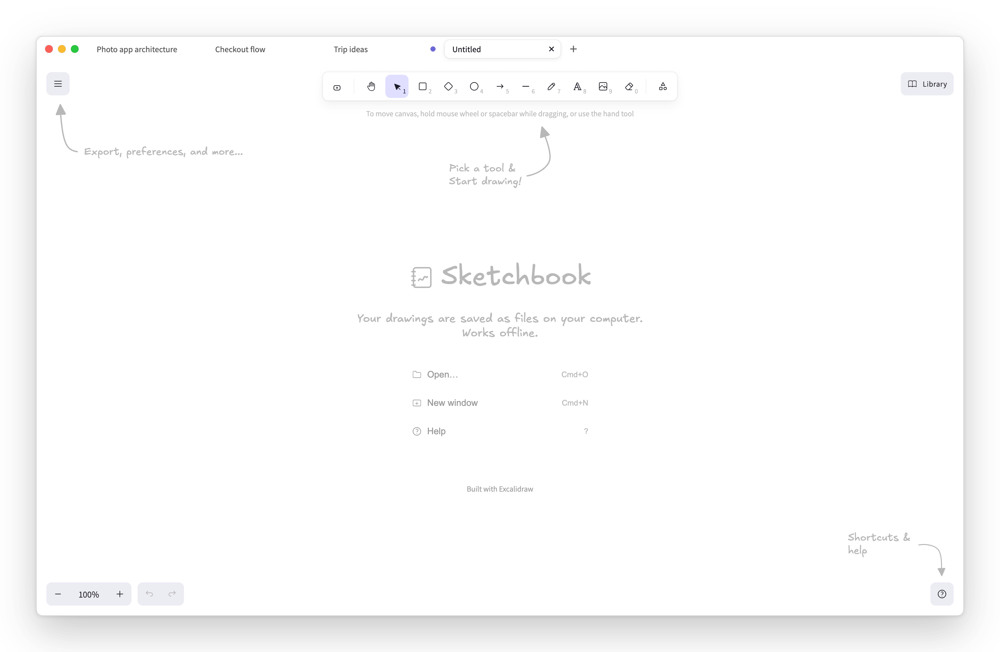
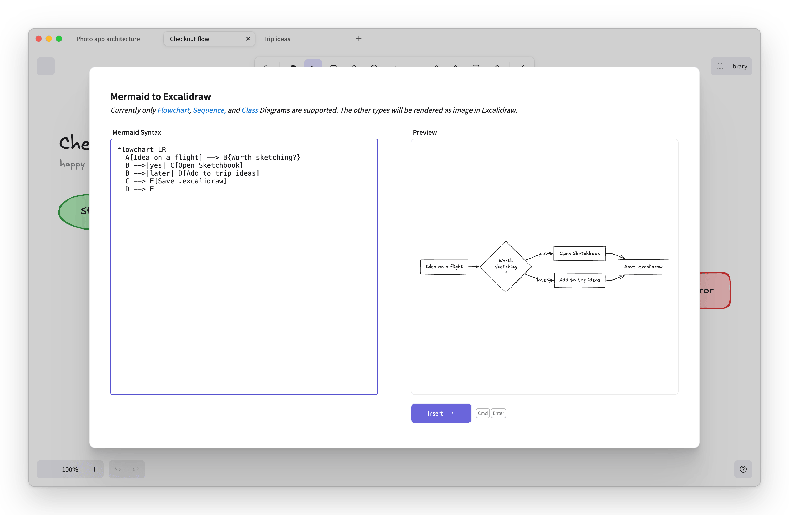
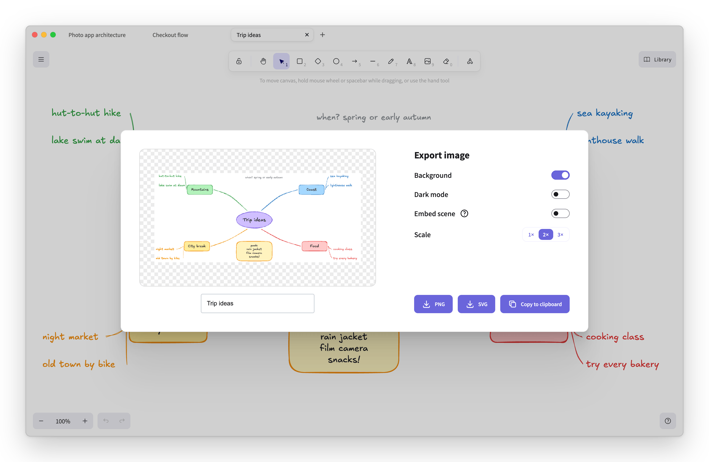

<div align="center">

# Sketchbook

**An offline desktop whiteboard, built on Excalidraw.**

[](LICENSE)
[](https://github.com/3333444n/sketchbook/actions/workflows/ci.yml)
[](#install)

<picture>
  <source media="(prefers-color-scheme: dark)" srcset="docs/images/hero-dark.png" />
  
</picture>

</div>

## Why

Whiteboards shouldn't need Wi-Fi. Sketchbook is for sketching on a flight, on a train or
anywhere else without internet, and for keeping your drawings as files that are yours. It
wraps the [Excalidraw](https://github.com/excalidraw/excalidraw) editor in a native macOS app. Drawings are ordinary `.excalidraw` files on your disk, and the app never talks to
the network: no accounts, no sync, no telemetry.

## Features

- **Works fully offline.** Every asset, including all of Excalidraw's fonts, ships inside the
  app. It makes zero network requests, and that is enforced by a strict CSP, a main-process
  request block and an end-to-end test.
- **Real `.excalidraw` files** with native Open and Save dialogs, Finder double-click, and
  Open Recent.
- **Tabs and multiple windows.** Drag tabs to reorder them, double-click a tab to rename the
  drawing, and press ⌘N for another window.
- **Crash recovery.** Unsaved changes are journaled and come back as dirty tabs after a crash.
  Your file only changes when you save.
- **PNG and SVG export** with the scene embedded, so an exported image opens again as an
  editable drawing.
- **Mermaid to diagram.** Paste a flowchart, sequence or class diagram and get editable shapes.
- **Light, dark and system theme.**
- **Keyboard shortcuts** for files and tabs, on top of all of Excalidraw's own.
- **Works with your AI agent (opt-in).** A bundled MCP server lets Claude Code, Claude
  Desktop, Cursor or Codex draw in the tab you're looking at and see the result. Local only,
  off by default. See [Use it with an AI agent](#use-it-with-an-ai-agent).

## Screenshots

<table>
  <tr>
    <td width="50%"><br /><sub>Tabs, with an unsaved change on "Trip ideas"</sub></td>
    <td width="50%"><br /><sub>A new tab</sub></td>
  </tr>
  <tr>
    <td width="50%"><br /><sub>Mermaid to diagram</sub></td>
    <td width="50%"><br /><sub>Export as PNG or SVG</sub></td>
  </tr>
</table>

The screenshots are generated from the production build with `pnpm screenshots`.

## Install

You need a Mac with Apple Silicon (an M1, M2, M3, M4 or newer chip) running macOS 12 or later.
Not sure? Click the Apple menu → **About This Mac** and look at **Chip**.

1. Go to the [latest release](https://github.com/3333444n/sketchbook/releases/latest) and
   click **`Sketchbook-<version>-arm64.dmg`** under **Assets** to download it.
2. Open the downloaded file (it is in your **Downloads** folder). A window appears.
3. Drag the **Sketchbook** icon onto the **Applications** folder in that window.
4. You can now eject the installer: in Finder's sidebar, click the ⏏ next to **Sketchbook**.

### Opening it the first time

Sketchbook is free and open source, but it isn't registered with Apple (that costs a yearly
fee), so the first time you open it macOS warns that it can't verify the app. This only
happens once:

1. Open **Applications** and double-click **Sketchbook**. macOS shows a warning; click
   **Done** (or **OK**).
2. Open the Apple menu → **System Settings** → **Privacy & Security**.
3. Scroll down to **Security**. Next to the message about Sketchbook, click **Open Anyway**,
   then confirm with your password or Touch ID.
4. Sketchbook opens. From now on it opens like any other app.

<details>
<summary>Prefer the Terminal?</summary>

This does the same as steps 1–3:

```sh
xattr -cr /Applications/Sketchbook.app
```

</details>

### Getting started

- **Draw** with the toolbar at the top, just like excalidraw.com. Press `?` to see every
  shortcut.
- **Save** with ⌘S. Drawings are ordinary `.excalidraw` files, saved wherever you choose (your
  **Documents** folder by default). Double-click one in Finder to open it in Sketchbook.
- **Tabs:** ⌘T opens a new tab. **Double-click a tab's name to rename the drawing**; if it's
  already saved, the file on your Mac is renamed too.
- **Export a picture** with ⇧⌘E (PNG or SVG). Exports keep the drawing inside them, so you
  can open an exported image in Sketchbook and keep editing.
- **Nothing gets lost:** if your Mac or the app crashes, your unsaved drawings come back as
  tabs the next time you open Sketchbook.
- **No internet needed.** Sketchbook never connects to the network.

### Updating

Sketchbook doesn't update itself (it never goes online). To get a new version, download the
latest dmg from [Releases](https://github.com/3333444n/sketchbook/releases/latest) and drag
Sketchbook to Applications again, choosing **Replace**. Your drawings and settings are kept.
To hear about new versions, click **Watch → Custom → Releases** on the GitHub page.

### Uninstall

Drag **Sketchbook** from **Applications** to the Trash. Your drawings stay where you saved
them. To also remove settings and crash-recovery data, delete
`~/Library/Application Support/Sketchbook`. If you registered the MCP server with an agent,
remove that entry too (for Claude Code: `claude mcp remove sketchbook`).

## Build from source

Requires macOS on Apple Silicon, Node 24 and pnpm 10.

```sh
git clone https://github.com/3333444n/sketchbook.git
cd sketchbook
pnpm i            # install dependencies (also fetches Electron)
pnpm dev          # run with hot reload
pnpm test         # unit tests (Vitest)
pnpm test:e2e     # build, then run the Playwright end-to-end tests
pnpm build:mac    # build dist/Sketchbook-<version>-arm64.dmg
```

More in [docs/building-and-releasing.md](docs/building-and-releasing.md).

## Keyboard shortcuts

| Shortcut           | Action                                 |
| ------------------ | -------------------------------------- |
| ⌘T                 | New tab                                |
| ⌘N                 | New window                             |
| ⌘O                 | Open                                   |
| ⌘S                 | Save                                   |
| ⇧⌘S                | Save As                                |
| ⇧⌘E                | Export image                           |
| ⌘W                 | Close tab                              |
| ⇧⌘W                | Close window                           |
| ⌘1–⌘9              | Go to tab 1–8; ⌘9 goes to the last tab |
| ⌃Tab / ⌃⇧Tab       | Next / previous tab (also ⇧⌘] / ⇧⌘[)   |
| Double-click a tab | Rename the drawing                     |

All of Excalidraw's shortcuts work too (press `?` in the app for the full list).

## Use it with an AI agent

Sketchbook ships an [MCP](https://modelcontextprotocol.io) server, so a local AI agent can read
the drawing you're looking at, add or change shapes, text and arrows, and look at the result
as an image. Every agent edit is one undo step (⌘Z), marks the tab unsaved, and never touches
your file until you press ⌘S.

1. In Sketchbook, turn on **Allow agent connections**, from the **Agent** menu in the menu
   bar or from the ☰ menu in the top-left corner of the canvas (off by default; remembered).
2. Choose **Set up agent access…** (same two places) and copy the config for your agent. For
   Claude Code it's one command:

   ```sh
   claude mcp add sketchbook -e ELECTRON_RUN_AS_NODE=1 -- "/Applications/Sketchbook.app/Contents/MacOS/Sketchbook" "/Applications/Sketchbook.app/Contents/Resources/mcp/index.js"
   ```

3. Ask: "Draw this repo's architecture in Sketchbook" or "Fix the overlapping boxes in my
   drawing and show me."

This requires v1.1.0 or later (the v1.0.0 download does not include it).

The agent talks to the app over a local socket on your Mac; Sketchbook still makes no network
requests. Config for Claude Desktop, Cursor and Codex, the tool reference and the security
model are in [docs/agent-bridge.md](docs/agent-bridge.md).

## How it works

- An Electron app embeds the MIT-licensed `@excalidraw/excalidraw` component (0.18.1); there is
  no fork of excalidraw.com.
- The main process owns files, dialogs, menus and the recovery journal; each window's renderer
  owns its tabs and keeps at most five editors mounted.
- The UI is served from a private `app://` scheme with bundled fonts, a strict CSP and a network
  block, so it behaves the same with Wi-Fi off.
- The agent bridge is a Unix socket in the app's data folder (same user only, off by default)
  plus an MCP server shipped inside the app bundle and run by the app's own binary in Node
  mode.

Details: [docs/architecture.md](docs/architecture.md) and the
[architecture decision records](docs/adr/README.md).

## What's not included

Sketchbook leaves out the parts of excalidraw.com that need a server, because the point is a
whiteboard that works anywhere and keeps your data on your machine:

- **Live collaboration and share links**: both need a relay server and accounts.
- **Excalidraw's built-in AI features** (text-to-diagram, wireframe-to-code): they call a
  remote model. No AI is built into the app; instead, a local agent you already run can
  connect, opt-in (see [Use it with an AI agent](#use-it-with-an-ai-agent)).
- **Online library browsing** at libraries.excalidraw.com: it's a website. You can still import
  local `.excalidrawlib` files.

## Contributing

Issues and pull requests are welcome. Start with [COLLABORATING.md](COLLABORATING.md) for the
dev loop and PR checklist. AI coding agents should read [AGENTS.md](AGENTS.md). This project
follows the [Contributor Covenant](CODE_OF_CONDUCT.md); report security issues as described in
[SECURITY.md](SECURITY.md).

## Credits

Built with [Excalidraw](https://github.com/excalidraw/excalidraw) (MIT) and the fonts it ships
(Excalifont, Virgil, Nunito, Lilita One, Comic Shanns, Cascadia Code, Liberation Sans, Assistant
and Xiaolai). Their licenses are listed in [THIRD_PARTY_NOTICES.md](THIRD_PARTY_NOTICES.md).

Sketchbook is an independent project. It is not affiliated with or endorsed by Excalidraw.

## License

[MIT](LICENSE)
