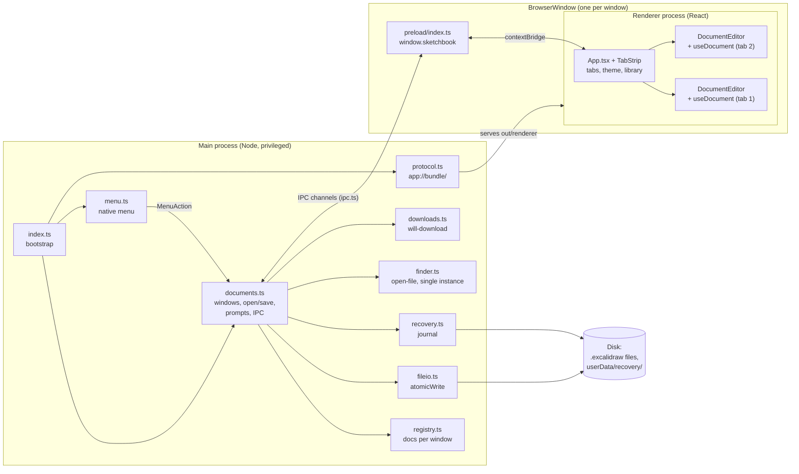
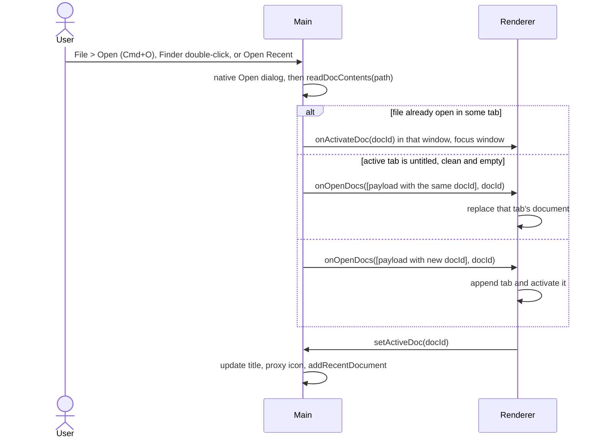
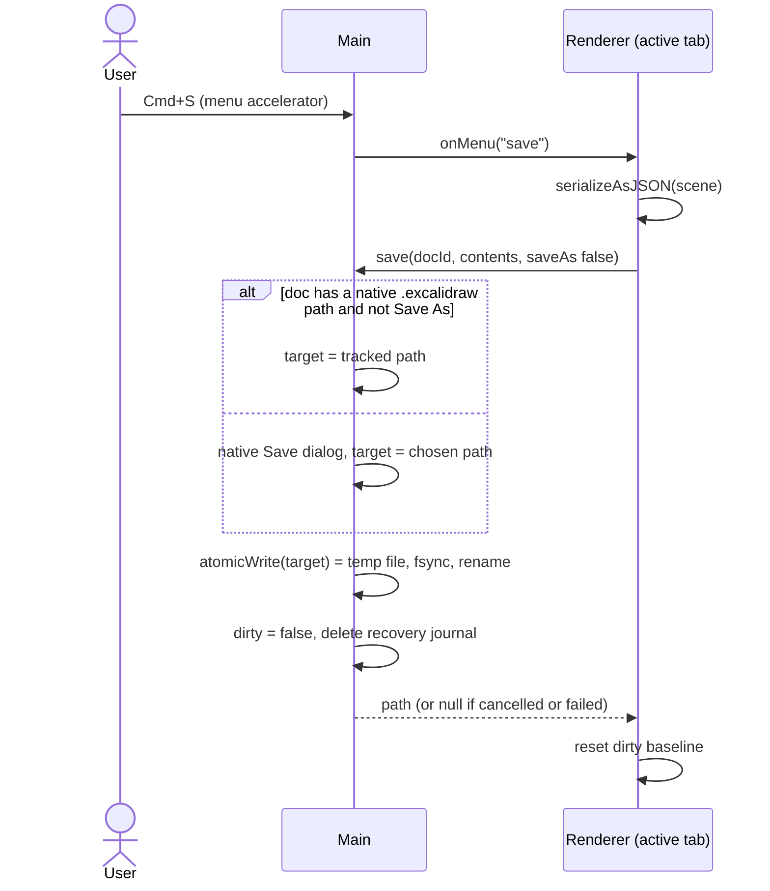
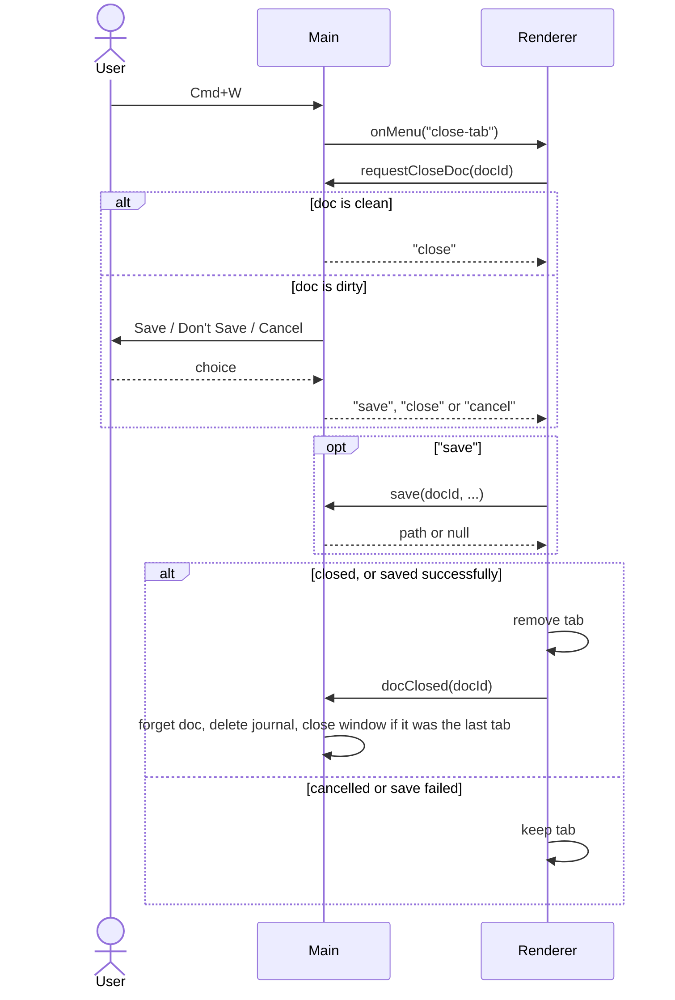
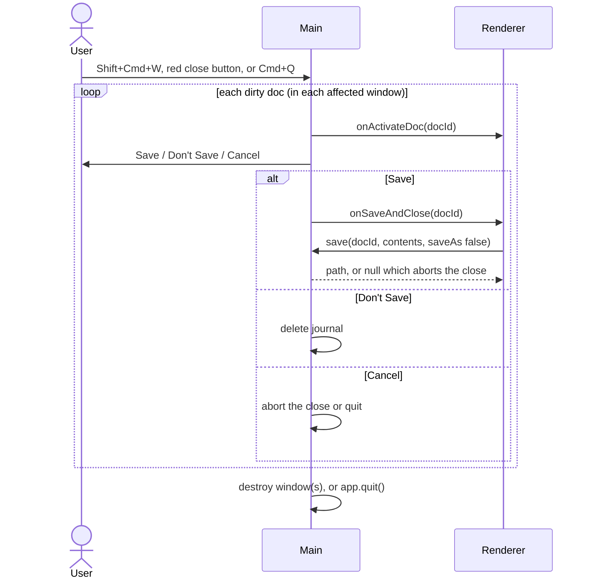
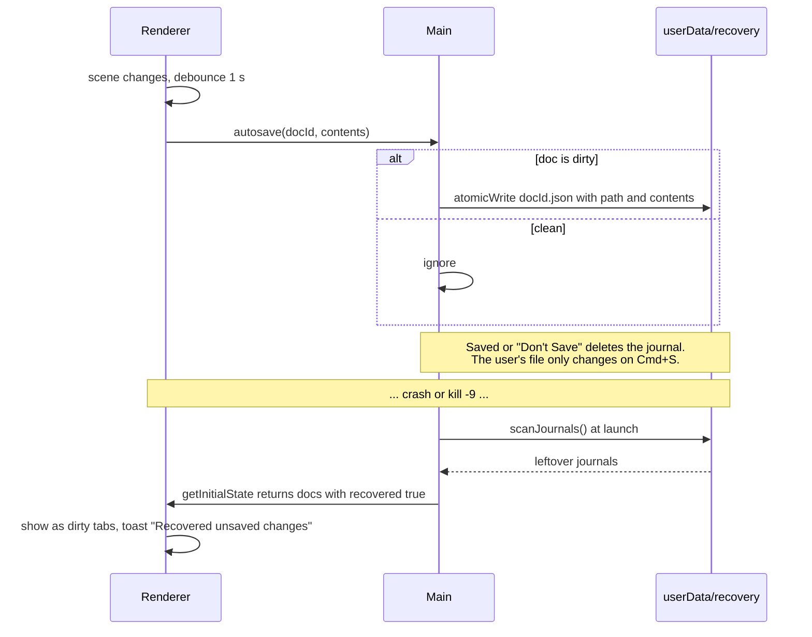

# Architecture

Sketchbook is an Electron app with the standard three layers. The only thing that crosses
layers is the contract in [`src/shared/ipc.ts`](../src/shared/ipc.ts) (v2: tabs), documented
in [ipc-contract.md](ipc-contract.md).

## Processes and layers

### Who owns what

| State                                             | Owner                                       |
| ------------------------------------------------- | ------------------------------------------- |
| Which docs exist, which window each lives in      | Main                                        |
| Each doc's path, dirty and empty flags            | Main (renderer reports dirty/empty)         |
| Window title, proxy icon, close-button dot        | Main (from the active doc)                  |
| Disk writes, dialogs, recovery journal            | Main                                        |
| Tab order, active tab, tab-strip UI               | Renderer                                    |
| Scene contents, undo history, Excalidraw UI state | Renderer (`DocumentEditor` / `useDocument`) |
| Theme preference, shape library                   | Renderer (`localStorage`, never scene data) |

### Windows and tabs

- Each window hosts an ordered set of tabs; each tab is one document with a stable `docId`.
- All tabs in a window share **one renderer process**. At most 5 Excalidraw editors are
  mounted, by most recent use; older tabs are snapshotted to JSON and remount on demand. See
  [performance.md](performance.md) and [ADR 0006](adr/0006-tabs-with-mru-editor-budget.md).
- The window is frameless (`titleBarStyle: 'hidden'`) with the traffic lights inside a 40px
  tab strip that doubles as the drag region. See [ADR 0007](adr/0007-frameless-window-custom-tab-strip.md).

| Shortcut                      | Action                                 | Handled by                       |
| ----------------------------- | -------------------------------------- | -------------------------------- |
| ⌘T                            | New tab                                | Main (menu)                      |
| ⌘N                            | New window                             | Main (menu)                      |
| ⌘O                            | Open (into the current window as tabs) | Main (menu)                      |
| ⌘S / ⇧⌘S                      | Save / Save As                         | Menu → `onMenu` → active tab     |
| ⇧⌘E                           | Export image                           | Menu → `onMenu` → active tab     |
| ⌘W                            | Close tab                              | Menu → `onMenu` → close-tab flow |
| ⇧⌘W                           | Close window                           | Main (menu)                      |
| ⌘1–⌘8, ⌘9                     | Switch to tab N; ⌘9 is the last tab    | Renderer (`shortcuts.ts`)        |
| ⌃Tab / ⌃⇧Tab (also ⇧⌘] / ⇧⌘[) | Next / previous tab                    | Menu → `onMenu` → renderer       |

Excalidraw binds some of the same keys. The renderer stops them from reaching Excalidraw
without cancelling them, so the menu accelerator still fires; see `src/renderer/src/shortcuts.ts`
and the gotchas in [AGENTS.md](../AGENTS.md).

### Security boundaries

- `contextIsolation: true`, `sandbox: true`, `nodeIntegration: false` on every window.
- The preload exposes only `SketchbookAPI`. Main validates the sender and arguments of every
  message and only acts on `docId`s that belong to the sending window.
- Main never writes to a path supplied by the renderer: only to a path it obtained from its own
  dialog or already tracks for that doc.
- Navigation away from the app is blocked; `window.open` is denied. External links go through
  `shell.openExternal` for `http:`, `https:` and `mailto:` only.
- Offline enforcement (CSP and `webRequest` block) is described in [offline.md](offline.md).

## Flows

### Open

PNG and SVG files with an embedded scene open like any other document. Because they aren't
the native format, a plain Save on them behaves as Save As `.excalidraw`.

### Save

### Close a tab (Cmd+W)

### Close a window or quit

### Crash recovery

Corrupt journals are moved to `userData/recovery/corrupt/` so they never block startup.
See [ADR 0005](adr/0005-recovery-journal.md).

## Known fragile spots

- **`src/renderer/src/portalGuard.ts`.** Excalidraw 0.18 keeps some UI state (notably the
  confirm dialog behind "Clear canvas") in a module-level jotai store shared by every
  `<Excalidraw>` on the page. Opening that dialog in one tab renders a modal portal on
  `<body>` for _every_ mounted editor, and confirming the wrong one would clear a hidden
  drawing. The guard finds each portal's owner by walking React's internal fiber
  (`__reactFiber$…`) up to the `.sketchbook-editor[data-doc-id]` wrapper and hides portals of
  inactive editors. It relies on React internals, so it can break on a React or Excalidraw
  upgrade. It fails safe: a portal whose owner can't be found stays visible, which is the
  behaviour without the guard.
- **Build-time patches to Excalidraw** in `electron.vite.config.ts` (CDN font fallback,
  embind `new Function`, subset-worker chunk). They throw and fail the build if Excalidraw's
  code changes shape.

Both are on the checklist in [upgrading-excalidraw.md](upgrading-excalidraw.md).

## Further reading

- [ADR index](adr/README.md) for the reasoning behind each of these choices.
- [offline.md](offline.md) for the `app://` protocol, fonts and the network block.
